# MiCuadre

**Sabe exactamente cuánto ganaste en cada turno.** MiCuadre es una app Android para conductores de
plataformas y taxi (InDriver, DiDi o cualquier otra). Registras cada carrera con un par de toques y
la app muestra al instante cuánto llevas en el turno, en el día, en la semana y en el mes,
separado en efectivo y transferencia.

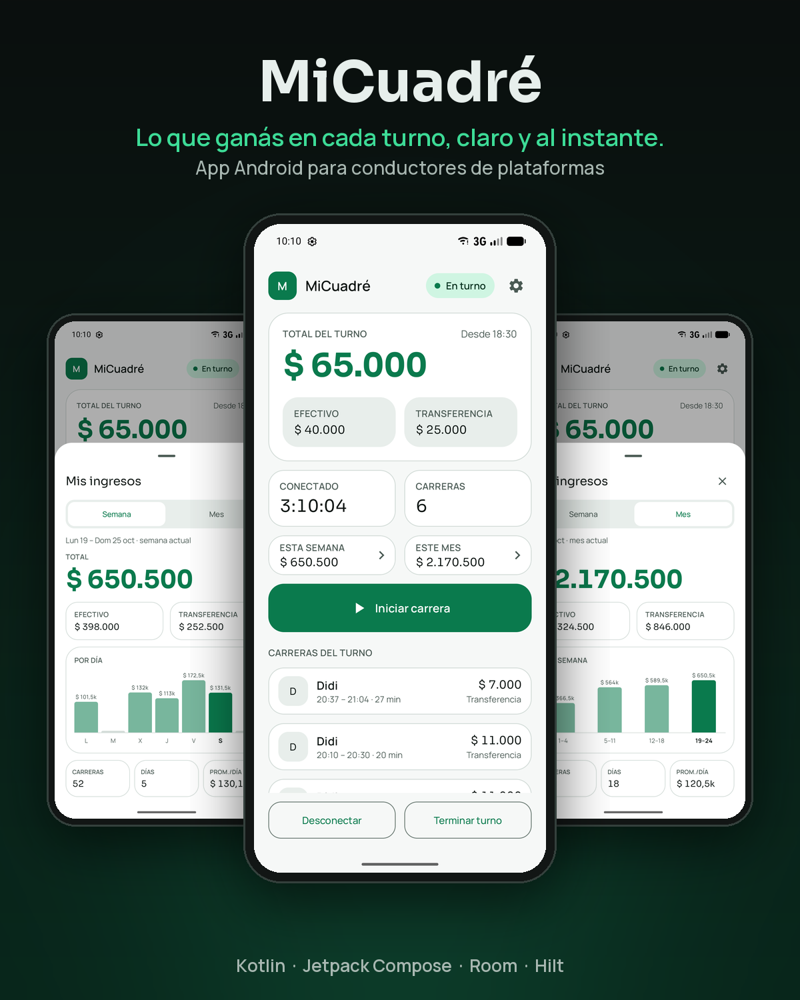

## Novedades en 0.4.0

- **Burbuja flotante.** Un acceso rápido sobre otras apps (mapas, apps de viajes) mientras hay un
  turno activo. Se arrastra, se pega al borde y al tocarla abre un panel con las acciones del
  momento: *Iniciar carrera*, *Terminar carrera*, *Cancelar carrera* y *Abrir app*.
- **Cancelar carrera.** Una carrera iniciada por error se puede descartar, con confirmación. No se
  suma a los totales y el turno vuelve a "Conectado".
- **Confirmación al terminar el turno.** *Terminar turno* pide confirmación, así un toque
  accidental ya no cierra el turno.
- **Nombre corregido.** La app se llama "MiCuadre" (sin tilde) y el encabezado de inicio muestra
  solo el nombre.

## Por qué existe

Los conductores que trabajan con varias apps suelen hacer *el cuadre* al final del día de memoria,
con capturas de pantalla o en un cuaderno. Eso es lento, propenso a errores y esconde los números
que importan: cuánto ganas por hora, qué días rinden y cuánto efectivo deberías tener en el
bolsillo.

MiCuadre lo reemplaza con un registro que construyes mientras manejas. Funciona sin internet y
todos los datos se quedan en tu teléfono.

| Objetivo | Cómo lo logra la app |
|----------|----------------------|
| Registrar nunca debe frenarte | Inicias y terminas carreras desde la notificación o la burbuja flotante, sin abrir la app |
| Conocer tus números siempre | Totales en vivo del turno, el día, la semana y el mes |
| Saber dónde está la plata | Cada carrera guarda si fue en efectivo o transferencia; los totales muestran ambos |
| Servir a cualquier conductor | Defines tus propias plataformas en Ajustes |

## Qué hace

- **Turnos.** Te conectas cuando empiezas a trabajar, pausas (desconectas) y retomas cuando lo
  necesites. Al terminar el turno, con confirmación, ves su resumen. El tiempo conectado no cuenta
  las pausas.
- **Carreras.** Inicias una carrera y la terminas indicando la plataforma, el monto y el medio de
  pago. La última plataforma y el último medio de pago quedan preseleccionados. Si la iniciaste por
  error, la cancelas y no se registra.
- **Burbuja flotante.** Opcional, se activa en *Ajustes › Burbuja flotante* y requiere el permiso
  "Mostrar sobre otras apps". Solo aparece mientras hay un turno activo y desaparece al terminarlo.
- **Resumen en inicio.**
  - *Conectado:* total del turno, tiempo conectado, cantidad de carreras y las carreras del turno.
  - *Desconectado:* resumen del día con todos los turnos, incluida la ganancia por hora.
- **Semana y mes.** Dos botones abren una hoja con el total, efectivo frente a transferencia, un
  gráfico de barras (por día en la semana, por semana en el mes), días trabajados y el promedio por
  día trabajado.
- **Tus plataformas.** En *Ajustes › Plataformas* creas, renombras, muestras u ocultas y eliminas
  plataformas. Eliminar una nunca cambia tu historial: las carreras pasadas conservan su nombre y
  sus totales.
- **Tema.** Sistema, claro, oscuro o automático por horario (oscuro de 18:00 a 06:00).

## Cómo se cuentan los números

| Regla | Por qué |
|-------|---------|
| Un turno cuenta completo para el día en que **empezó** | Un turno nocturno de 20:00 a 02:00 es un día de trabajo, no dos |
| La semana va de lunes a hoy; el mes, del día 1 a hoy | Coincide con calendarios, cuentas y metas |
| "Por hora" aparece solo después de una hora completa conectado | Evita tarifas absurdas extrapoladas de pocos minutos |
| Una carrera debe terminarse o cancelarse antes de desconectarte | Ninguna carrera queda registrada a medias |
| Una carrera cancelada no suma | Solo cuenta lo que realmente cobraste |

## Capturas

| Resumen de hoy | En turno | Semana |
|---|---|---|
| 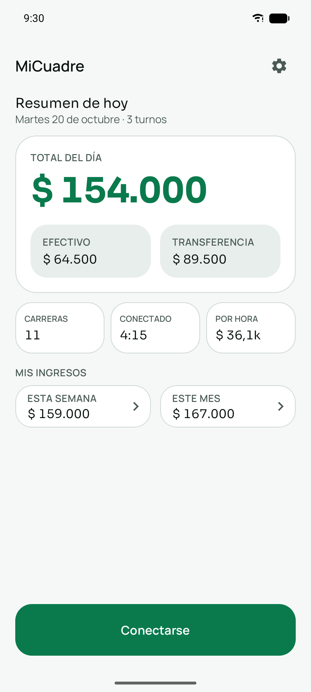 | 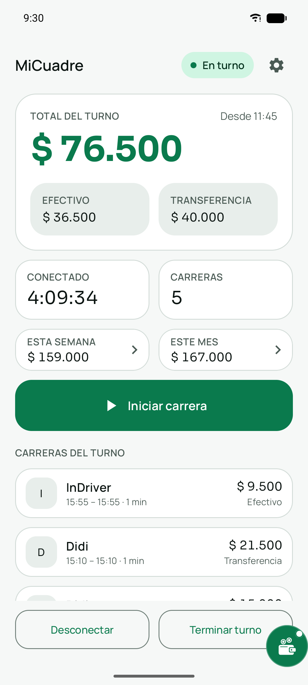 | 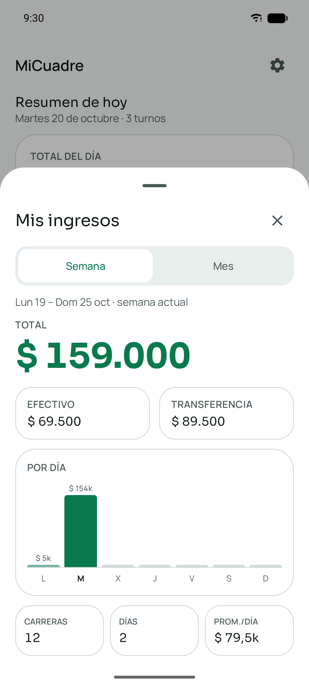 |

| Terminar carrera | Cancelar carrera | Terminar turno |
|---|---|---|
| 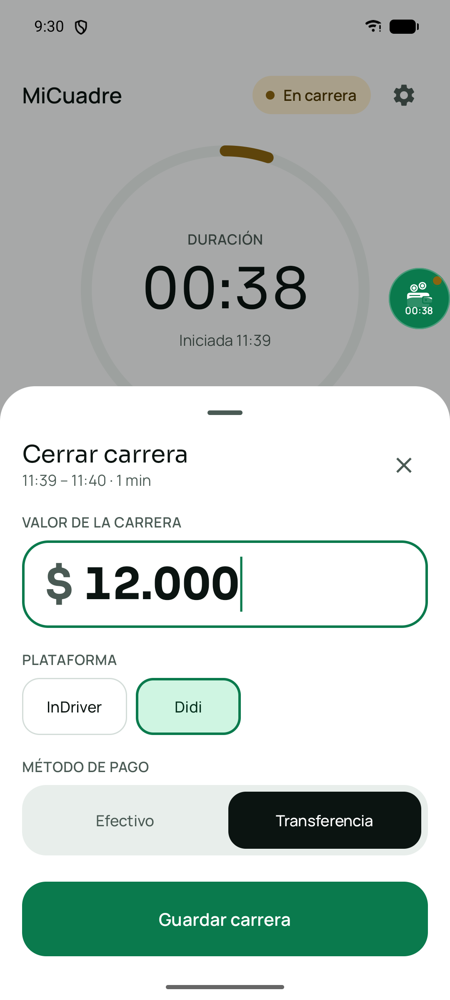 | 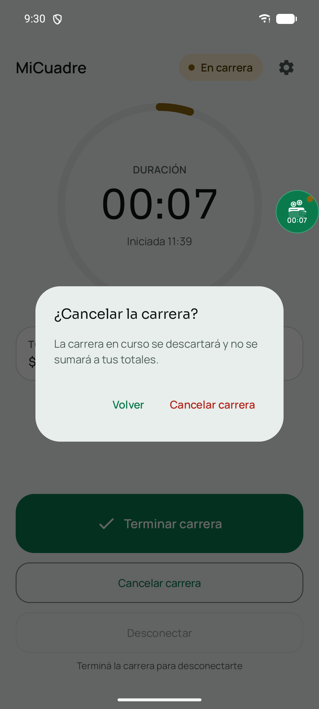 | 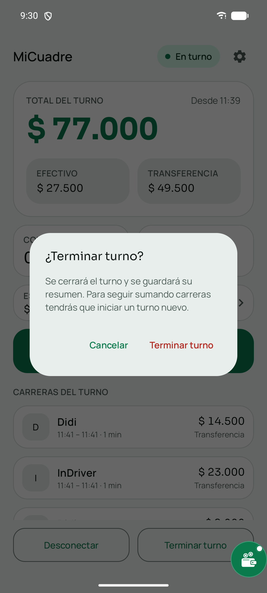 |

| Burbuja flotante | Panel de la burbuja | Ajustes |
|---|---|---|
| 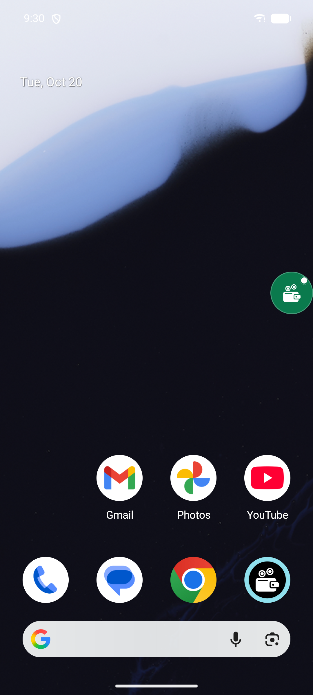 | 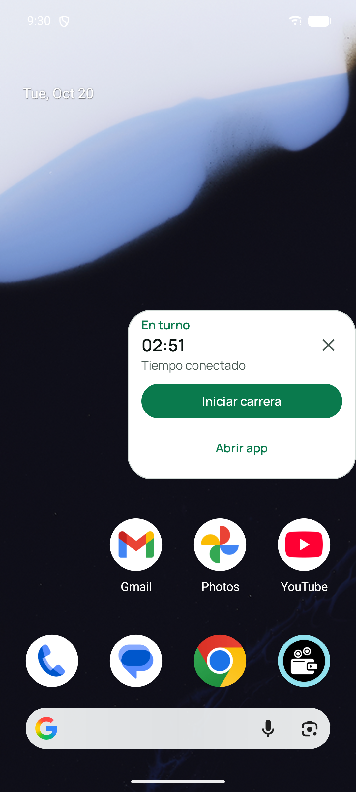 | 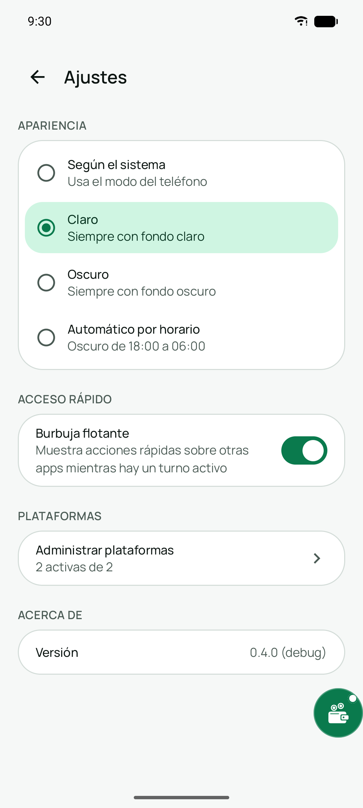 |

| Mes | Plataformas | Modo oscuro |
|---|---|---|
| 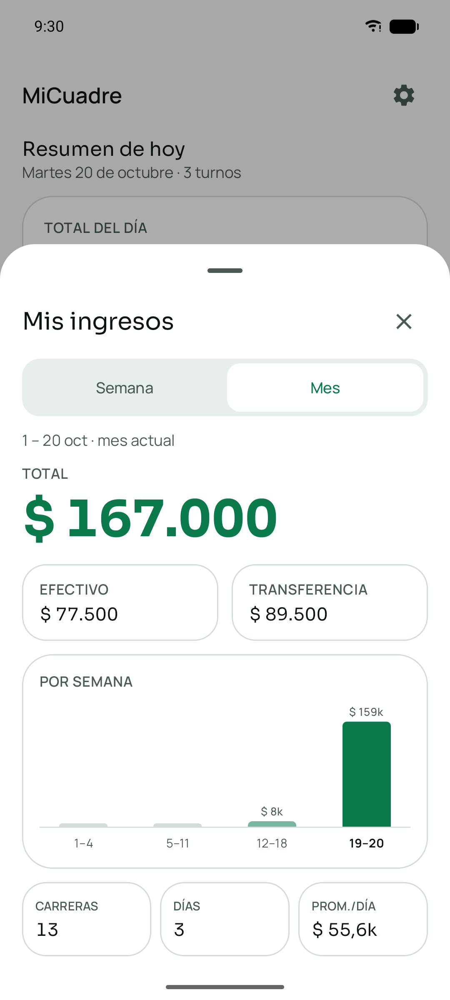 | 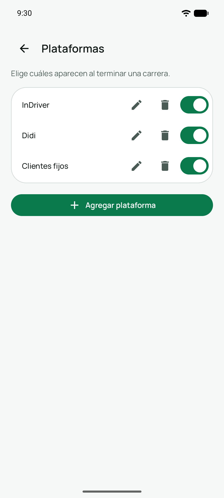 | 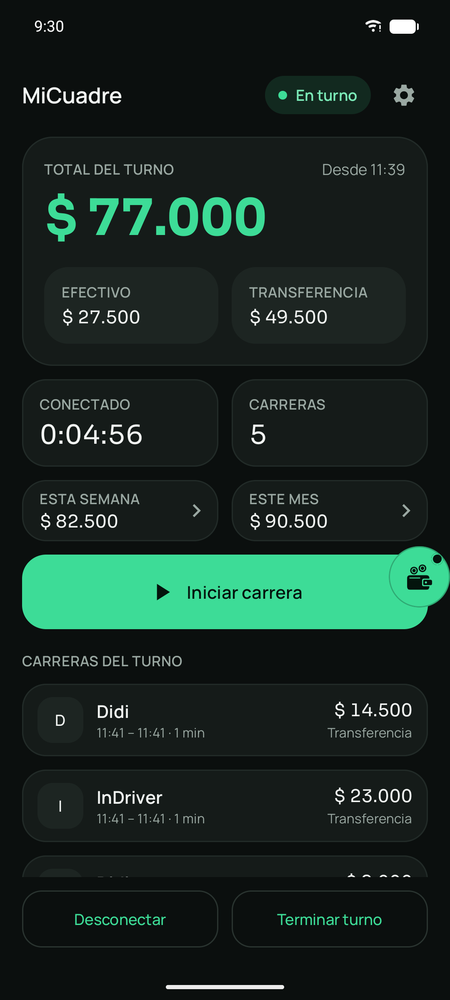 |

Las capturas usan datos de demostración.

## Inicio rápido (desarrolladores)

**Requisitos:** Android Studio (versión estable reciente), JDK 17 o superior (sirve el JDK incluido
en Android Studio) y un dispositivo o emulador con Android 10 (API 29) o superior.

1. Clona el repositorio y abre la carpeta del proyecto en Android Studio.
2. Ejecuta la configuración `app` en un dispositivo o emulador.
3. Corre las pruebas:

```bash
./gradlew testDebugUnitTest   # pruebas unitarias, de Room y de Robolectric
./gradlew assembleDebug       # APK de depuración en app/build/outputs/apk/debug/
```

La versión de depuración se instala como una app aparte (`com.micuadre.app.debug`), así que nunca
toca los datos de una instalación de producción.

## Stack técnico

| Área | Elección |
|------|----------|
| Lenguaje | Kotlin 2.0 |
| UI | Jetpack Compose con Material 3 (tema propio, fuentes Sora y Manrope) |
| Inyección de dependencias | Hilt |
| Almacenamiento | Room (turnos, carreras, intervalos conectados, plataformas) y DataStore (preferencias) |
| Trabajo en segundo plano | Un servicio en primer plano con acciones en la notificación y una ventana superpuesta (burbuja) |
| Asincronía | Kotlin Coroutines y Flow |
| Pruebas | JUnit 4, Robolectric, `MigrationTestHelper` de Room (unas 490 pruebas) |
| Build | Gradle Kotlin DSL con catálogo de versiones; `minSdk 29`, `targetSdk 35` |

## Arquitectura

El código sigue una arquitectura por capas (clean): la UI depende del dominio y el dominio no sabe
nada del almacenamiento de Android.

```text
app/src/main/kotlin/com/micuadre/app/
├── domain/        Reglas de negocio: modelos, interfaces de repositorio, casos de uso
├── data/          Entidades de Room, DAOs, migraciones e implementaciones de repositorio
├── presentation/  ViewModels, coordinadores, modelos de UI y pantallas Compose
├── service/       Servicio del turno en primer plano, notificación y su máquina de estados
├── overlay/       Burbuja flotante: ventana, panel, arrastre y permiso
├── ui/theme/      Colores, tipografía y tema
├── di/            Módulos de Hilt
└── util/          Utilidades de formato, versión y tiempo
```

Decisiones clave:

- **Las migraciones de base de datos son reales y están probadas.** Cada versión del esquema (hoy
  v3) trae una `Migration` y una prueba con `MigrationTestHelper` que la ejecuta sobre datos
  existentes.
- **El tiempo se inyecta.** Un `Clock` y la zona horaria los provee Hilt, así que los límites de
  día, semana y mes, el cambio de medianoche y los cambios de zona horaria tienen pruebas unitarias.
- **La lógica vive fuera de los composables.** Las pantallas solo pintan modelos de UI puros,
  cubiertos con pruebas JVM simples. La burbuja sigue la misma regla: posición, arrastre, visibilidad
  y acciones del panel son lógica pura con pruebas.

## Versionado

La app sigue [Semantic Versioning](https://semver.org). La versión vive en un solo archivo,
`version.properties`, y el `versionCode` de Android se deriva de ella como
`major × 10000 + minor × 100 + patch`. La versión instalada se ve en *Ajustes › Acerca de*. Cada
versión se etiqueta en git (`v0.4.0`) y los cambios se listan en [CHANGELOG.md](CHANGELOG.md).

## Hoja de ruta

- Sincronización opcional de las carreras con Google Sheets.
- Una pantalla de historial para recorrer turnos y carreras pasados.

## Estado del proyecto

MiCuadre está en desarrollo activo (versión actual **0.4.0**). Su autor la usa primero como
herramienta diaria de conductor, con el objetivo de abrirla a cualquier conductor de plataformas.
